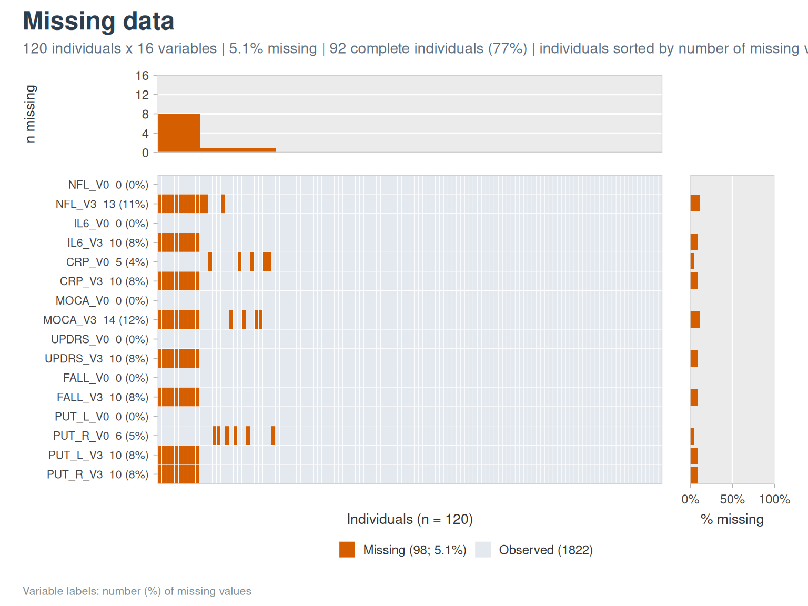
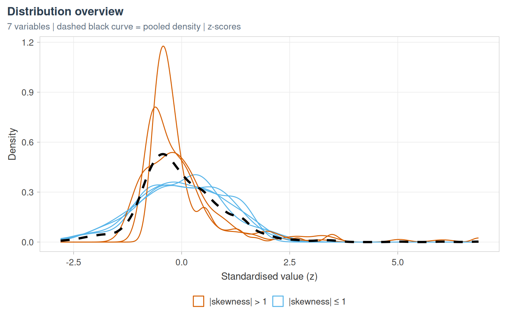
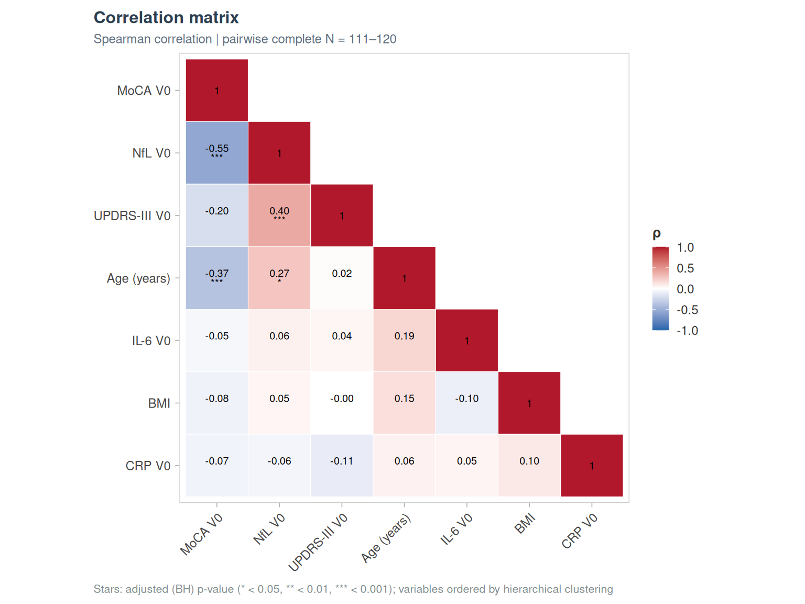
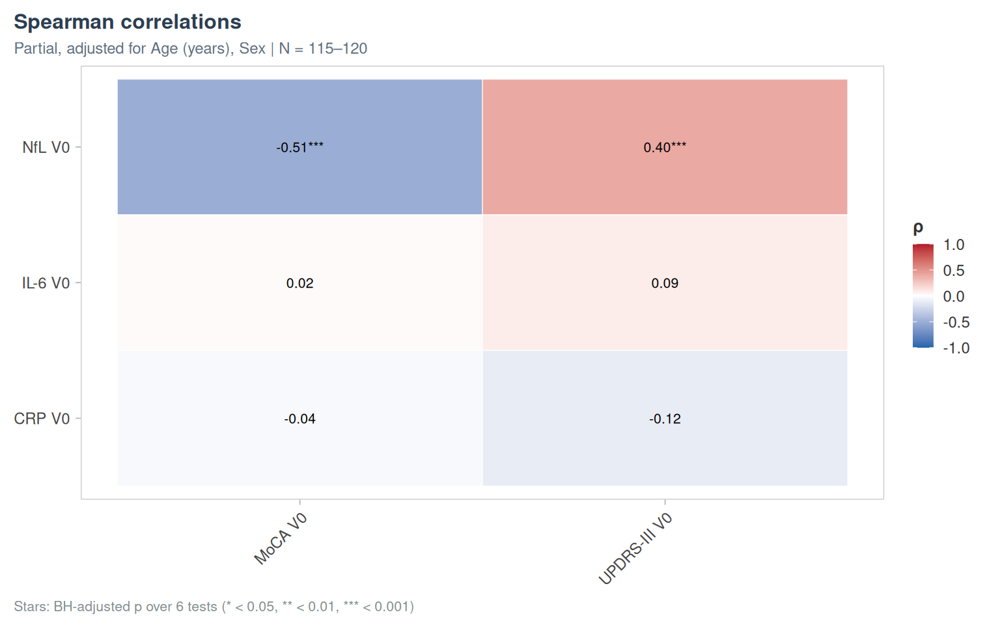
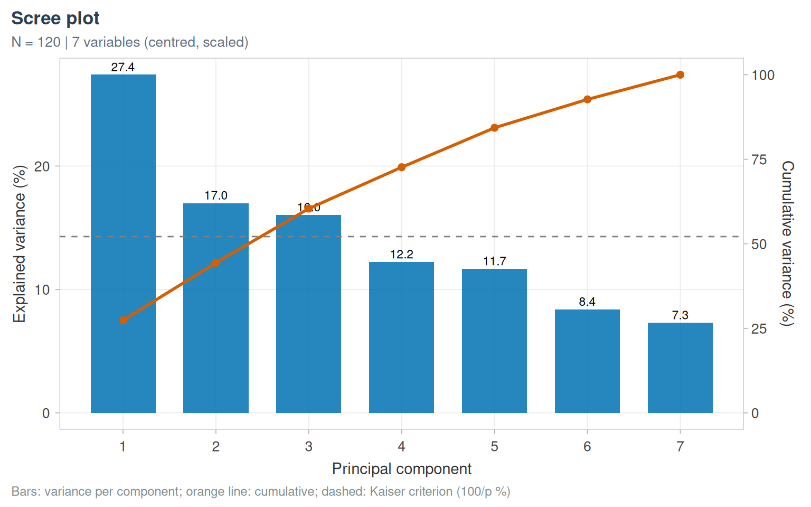
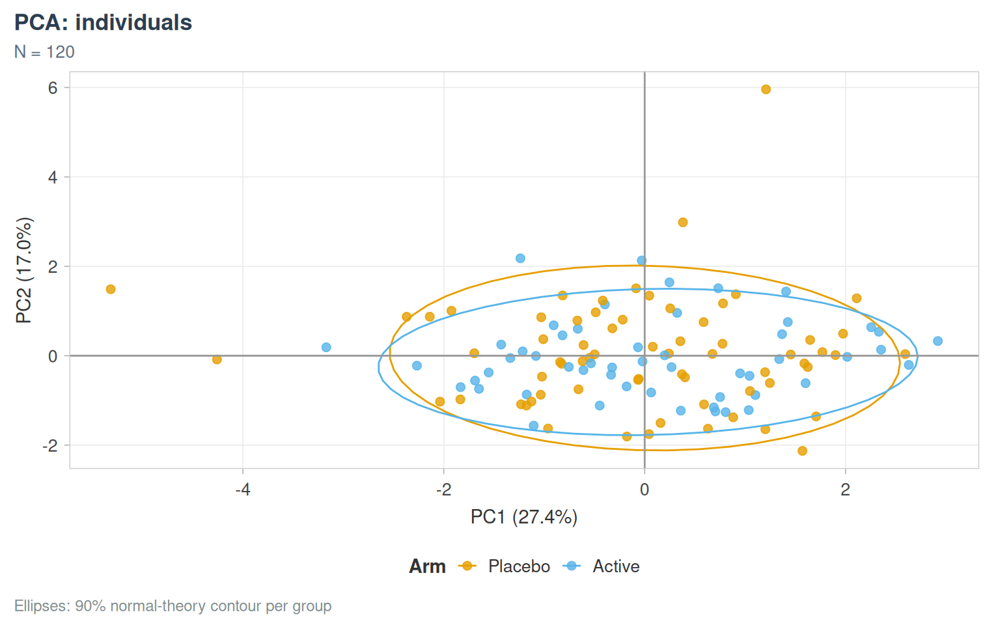
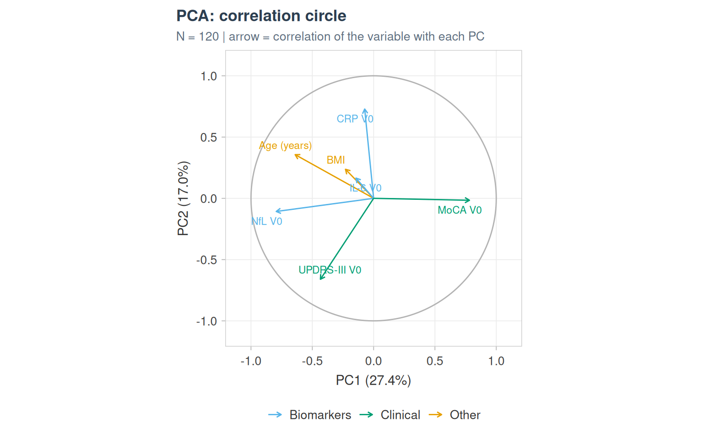
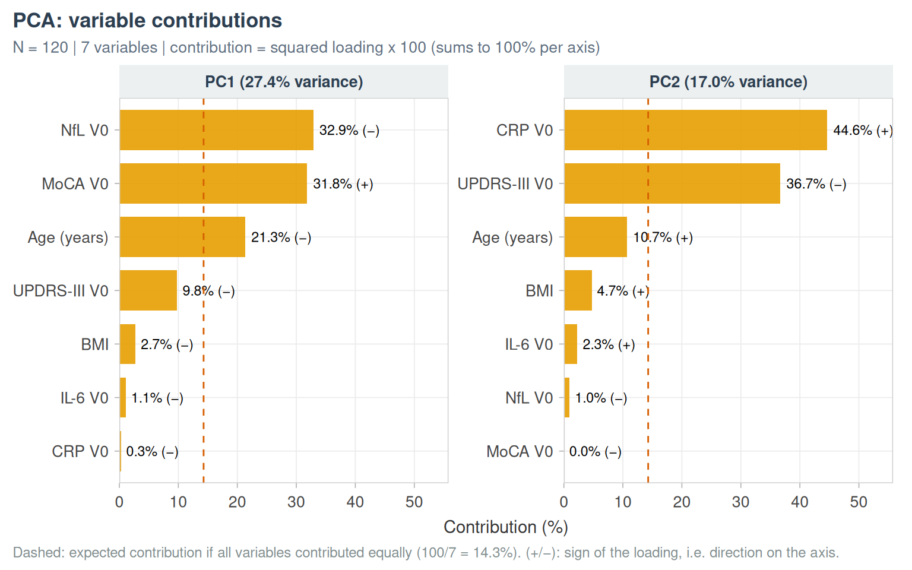
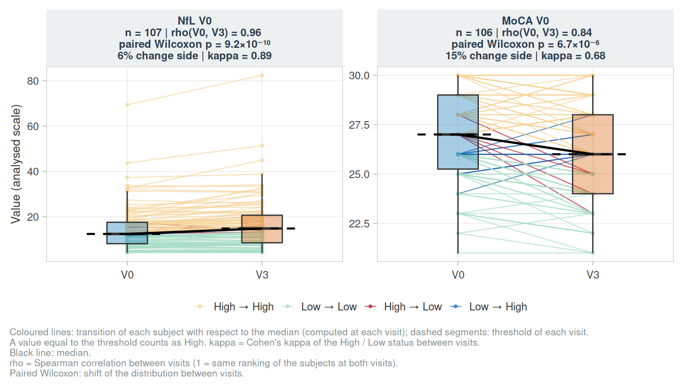

# Describing a cohort

``` r

library(vernissage)
labs <- c(AGE = "Age (years)", BMI = "BMI", SEX = "Sex", NFL_V0 = "NfL V0", IL6_V0 = "IL-6 V0",
          CRP_V0 = "CRP V0", MOCA_V0 = "MoCA V0", UPDRS_V0 = "UPDRS-III V0", FALL_V0 = "Falls V0",
          GROUP = "Arm")
```

## The cohort overview table

[`describe_cohort()`](https://clement-poupelin.github.io/vernissage/reference/describe_cohort.md)
is the first table of an analysis: type, number observed, missing
values, summaries overall and by group, a group comparison and a small
histogram of each variable.

``` r

describe_cohort(cohort_sim,
                vars = c(AGE, SEX, BMI, NFL_V0, IL6_V0, CRP_V0, MOCA_V0, UPDRS_V0, FALL_V0),
                by = GROUP, id_col = ID, labels = labs,
                blocks = list(Demography = c("AGE", "SEX", "BMI"),
                              Biomarkers = c("NFL_V0", "IL6_V0", "CRP_V0"),
                              Clinical = c("MOCA_V0", "UPDRS_V0", "FALL_V0")))
```

[TABLE]

The same content is available as a tibble with `output = "data"`.

## Missing data

``` r

na_summary(cohort_sim, list(Biomarkers = c("NFL_V0", "NFL_V3", "IL6_V3", "CRP_V0"),
                            Scores = c("MOCA_V3", "UPDRS_V3")))
#> # A tibble: 6 × 5
#>   Block      Variable Label    N_missing Pct_missing
#>   <chr>      <chr>    <chr>        <int>       <dbl>
#> 1 Scores     MOCA_V3  MOCA_V3         14        11.7
#> 2 Biomarkers NFL_V3   NFL_V3          13        10.8
#> 3 Biomarkers IL6_V3   IL6_V3          10         8.3
#> 4 Scores     UPDRS_V3 UPDRS_V3        10         8.3
#> 5 Biomarkers CRP_V0   CRP_V0           5         4.2
#> 6 Biomarkers NFL_V0   NFL_V0           0         0
na_complete_cases(cohort_sim, list(Baseline = c("NFL_V0", "IL6_V0", "CRP_V0", "MOCA_V0"),
                                   `Both visits` = c("NFL_V0", "NFL_V3", "MOCA_V0", "MOCA_V3")))
#> # A tibble: 2 × 4
#>   `Variable set` `N variables` `N complete` `% complete`
#>   <chr>                  <int>        <int>        <dbl>
#> 1 Baseline                   4          115         95.8
#> 2 Both visits                4          103         85.8
```

``` r

plot_na_map(cohort_sim, c(NFL_V0:PUT_R_V3), id_col = ID, orientation = "rows")
```



## Normality

``` r

describe_normality(cohort_sim, c(AGE, BMI, NFL_V0, IL6_V0, CRP_V0, MOCA_V0), labels = labs)
#> # A tibble: 6 × 9
#>   Variable Label           N     W p_Shapiro     p_AD Skewness Kurtosis Verdict 
#>   <chr>    <chr>       <int> <dbl>     <dbl>    <dbl>    <dbl>    <dbl> <chr>   
#> 1 AGE      Age (years)   120 0.989  4.37e- 1 2.12e- 1  -0.0891    0.229 Compati…
#> 2 BMI      BMI           116 0.987  3.47e- 1 6.55e- 1  -0.192    -0.354 Compati…
#> 3 NFL_V0   NfL V0        120 0.808  3.08e-11 1.49e-10   2.48     10.5   Strong …
#> 4 IL6_V0   IL-6 V0       120 0.712  4.97e-14 3.7 e-24   2.48      7.04  Strong …
#> 5 CRP_V0   CRP V0        115 0.589  2.00e-16 3.7 e-24   3.93     20.2   Strong …
#> 6 MOCA_V0  MoCA V0       120 0.947  1.22e- 4 1.16e- 4  -0.335    -0.561 Slight …
```

``` r

plot_distribution_overview(cohort_sim, c(AGE, BMI, NFL_V0, IL6_V0, CRP_V0, MOCA_V0, UPDRS_V0), labels = labs)
```



## Correlations

``` r

cm <- cor_matrix_test(cohort_sim, c(AGE, BMI, NFL_V0, IL6_V0, CRP_V0, MOCA_V0, UPDRS_V0))
plot_cor_heatmap(cm, labels = labs)
```



Partial correlations, adjusted for age and sex:

``` r

cc <- plot_cor_cross(cohort_sim, c(NFL_V0, IL6_V0, CRP_V0), c(MOCA_V0, UPDRS_V0),
                     covariates = c(AGE, SEX), labels = labs)
cc$plot
```



## Principal component analysis

``` r

pc <- pca_compute(cohort_sim, c(AGE, BMI, NFL_V0, IL6_V0, CRP_V0, MOCA_V0, UPDRS_V0), id_col = ID,
                  impute = "median")
plot_pca_scree(pc)
```



``` r

plot_pca_ind(pc, cohort_sim, id_col = ID, color_var = GROUP, labels = labs)
```



``` r

plot_pca_var(pc, labels = labs, groups = list(Biomarkers = c("NFL_V0", "IL6_V0", "CRP_V0"),
                                              Clinical = c("MOCA_V0", "UPDRS_V0")))
```



``` r

plot_pca_contrib(pc, axes = 1:2, labels = labs)
```



## Changes between visits

``` r

plot_paired_visits(cohort_sim, c(NFL_V0, MOCA_V0), id_col = ID, labels = labs, transitions = TRUE)
```



The reclassification table of categorised variables between visits is
`lodestar::cut_transition_table()`.
