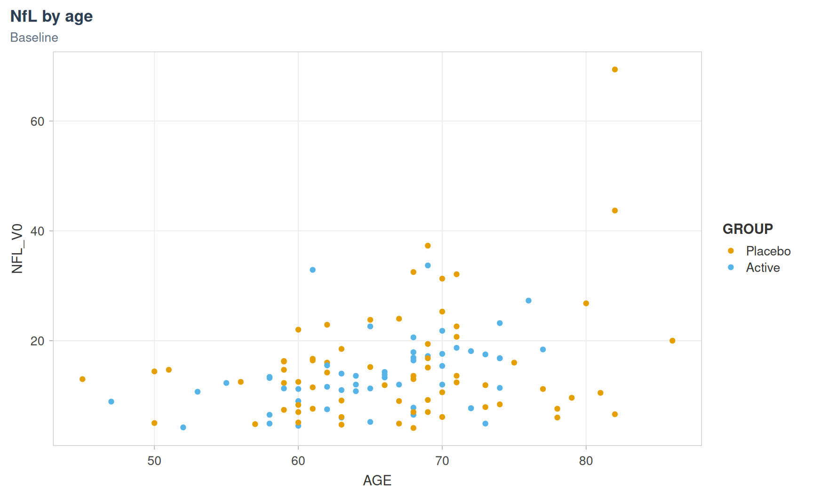
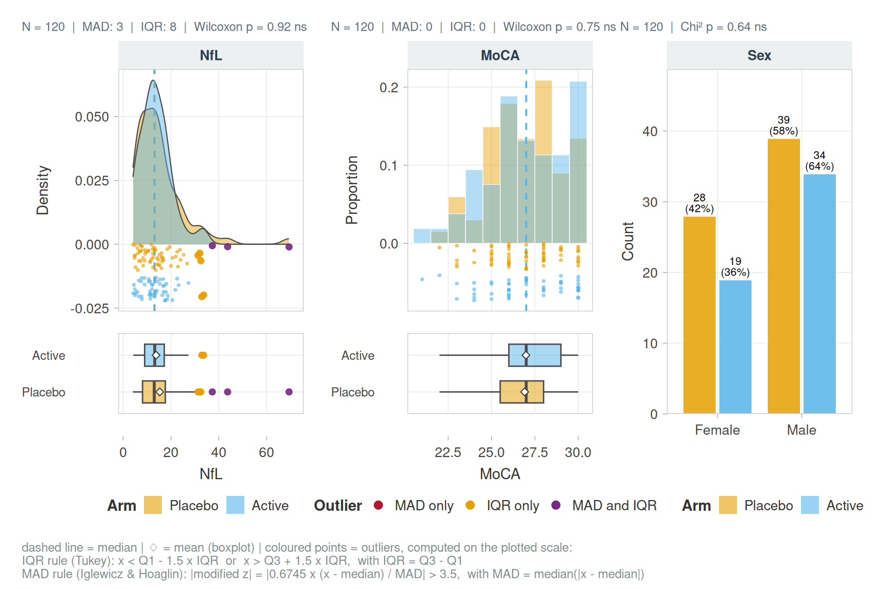
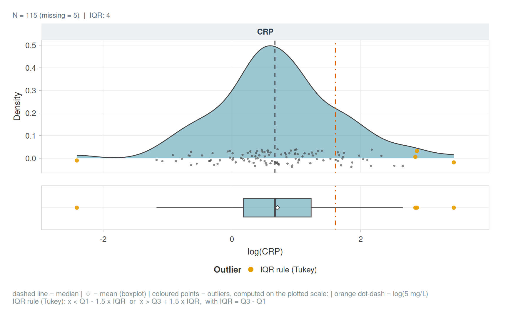
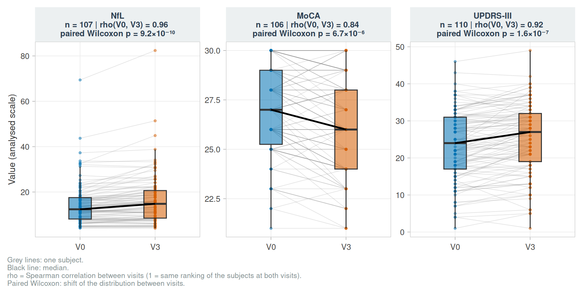
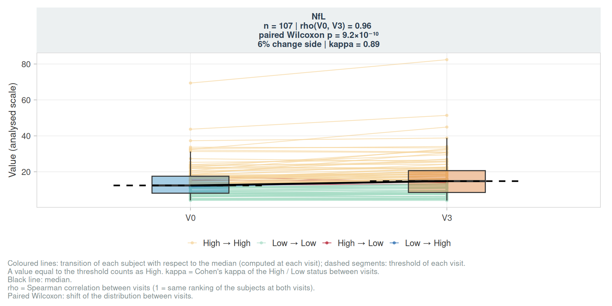
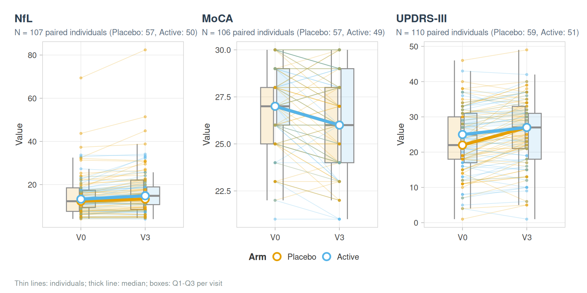
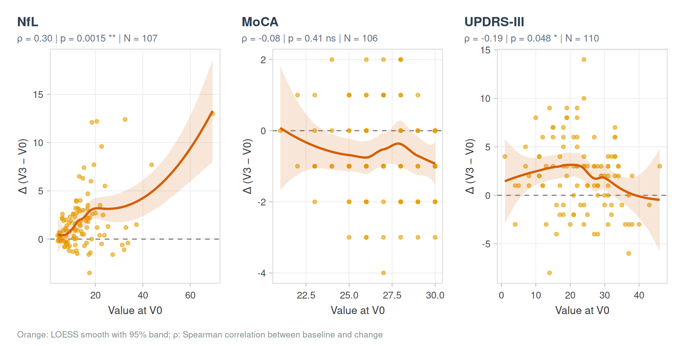
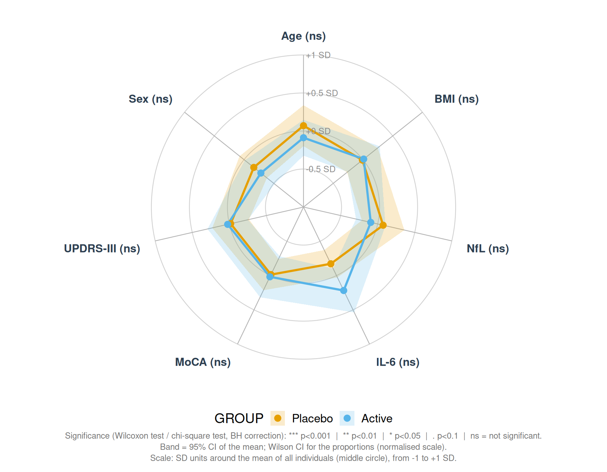
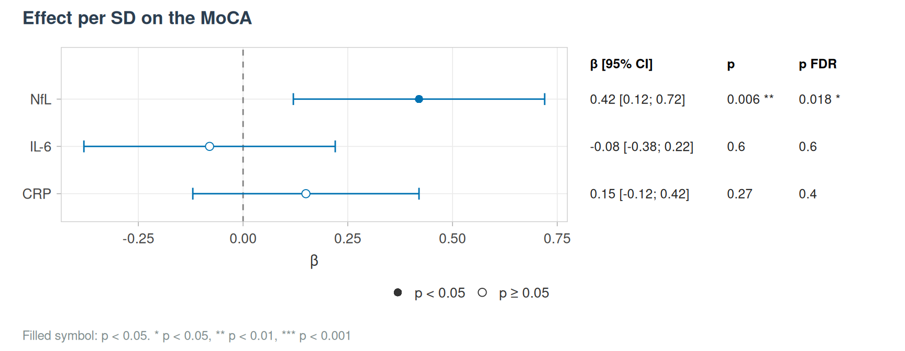

# Figures

``` r

library(vernissage)
library(ggplot2)
labs <- c(NFL_V0 = "NfL", MOCA_V0 = "MoCA", UPDRS_V0 = "UPDRS-III", CRP_V0 = "CRP", SEX = "Sex",
          GROUP = "Arm", AGE = "Age", BMI = "BMI", IL6_V0 = "IL-6", NFL = "NfL", MOCA = "MoCA",
          UPDRS = "UPDRS-III")
```

## Theme and palettes

Every figure uses
[`theme_pub()`](https://clement-poupelin.github.io/vernissage/reference/theme_pub.md)
and the colour-blind safe Okabe-Ito palette.

``` r

ggplot(cohort_sim, aes(AGE, NFL_V0, colour = GROUP)) +
  geom_point() +
  scale_colour_manual(values = pal_levels(levels(cohort_sim$GROUP))) +
  labs(title = "NfL by age", subtitle = "Baseline") +
  theme_pub()
```



## Distributions

Continuous variables get a density, jittered points and a boxplot;
integer scores a histogram with bin width 1; categorical variables a bar
chart. Outliers are coloured by the rule that flags them, and a group
test is given for each panel.

``` r

p <- plot_distribution(cohort_sim, c(NFL_V0, MOCA_V0, SEX), group = GROUP, labels = labs,
                       outlier_mad = TRUE)
p
```



``` r

attr(p, "tests")
#> # A tibble: 3 × 4
#>   Variable Test         p p_adj_BH
#>   <chr>    <chr>    <dbl>    <dbl>
#> 1 NFL_V0   Wilcoxon 0.924    0.924
#> 2 MOCA_V0  Wilcoxon 0.747    0.924
#> 3 SEX      Chi²     0.636    0.924
```

Display transformation and reference lines:

``` r

plot_distribution(cohort_sim, CRP_V0, transform = "log", labels = labs,
                  ref_lines = list(CRP_V0 = log(5)), ref_label = "log(5 mg/L)")
```



## Paired visits

``` r

plot_paired_visits(cohort_sim, c(NFL_V0, MOCA_V0, UPDRS_V0), id_col = ID, labels = labs)
```



``` r

plot_paired_visits(cohort_sim, NFL_V0, id_col = ID, labels = labs, transitions = TRUE)
```



``` r

plot_trajectory_grid(cohort_sim, c("NFL", "MOCA", "UPDRS"), id_col = ID, group = GROUP, labels = labs)
```



``` r

plot_delta_vs_baseline(cohort_sim, c("NFL", "MOCA", "UPDRS"), labels = labs)
```



## Radar plot

``` r

plot_radar(cohort_sim, c(AGE, BMI, NFL_V0, IL6_V0, MOCA_V0, UPDRS_V0, SEX), group = GROUP,
           labels = labs, normalize = "zscore", quali_levels = list(SEX = "Female"), seed = 1)
```



## Forest plot

[`plot_forest()`](https://clement-poupelin.github.io/vernissage/reference/plot_forest.md)
draws any table of estimates with their confidence intervals and
p-values, e.g. results computed elsewhere.

``` r

est <- data.frame(label = c("NfL", "IL-6", "CRP"), estimate = c(0.42, -0.08, 0.15),
                  conf.low = c(0.12, -0.38, -0.12), conf.high = c(0.72, 0.22, 0.42),
                  p.value = c(0.006, 0.6, 0.27), p_adj = c(0.018, 0.6, 0.4))
plot_forest(est, p_adj = p_adj, effect_label = "β", title = "Effect per SD on the MoCA")
```


