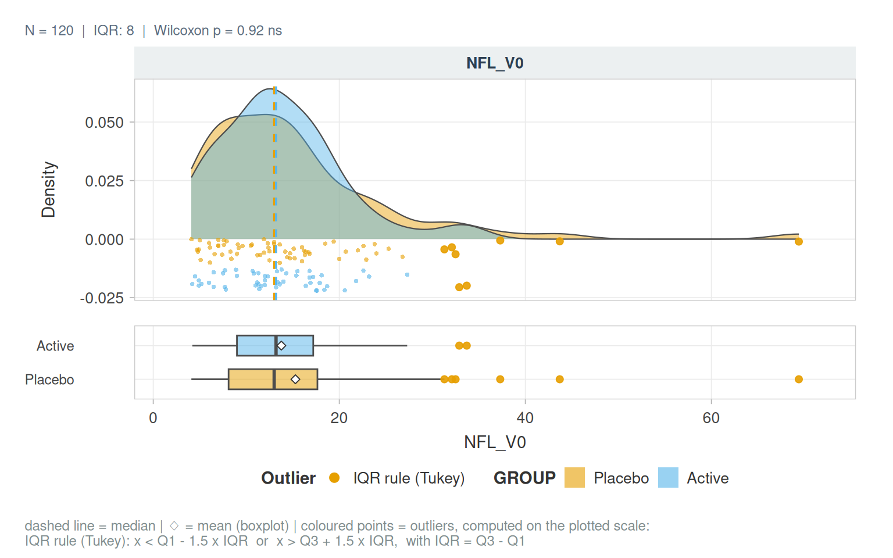

# Tables and Quarto reports

``` r

library(vernissage)
```

## Formatting numbers

``` r

fmt_p(c(0.21, 0.031, 0.00042, 1e-20))
#> [1] "0.21"       "0.031"      "4.2×10⁻⁴"   "<2.2×10⁻¹⁶"
fmt_num(c(1.2345, 0.00002, 2.5e7), digits = 2)
#> [1] "1.23"     "2.0×10⁻⁵" "2.5×10⁷"
fmt_stars(c(0.2, 0.07, 0.03, 0.004))
#> [1] "ns" "."  "*"  "**"
```

## Publication tables

[`gt_pub()`](https://clement-poupelin.github.io/vernissage/reference/gt_pub.md)
rounds numbers, detects and formats p-value columns, and puts p \< 0.05
in bold.
[`gt_signif()`](https://clement-poupelin.github.io/vernissage/reference/gt_signif.md)
adds shades of green for nominal and FDR-significant results.

``` r

cm <- cor_matrix_test(cohort_sim, c(NFL_V0, IL6_V0, CRP_V0, MOCA_V0, UPDRS_V0))
gt_pub(cm$long, title = "Spearman correlations", note = "Pairwise complete observations") |>
  gt_signif(p_cols = "p", fdr_cols = "p_adj")
```

| Spearman correlations |  |  |  |  |  |
|----|----|----|----|----|----|
| Var1 | Var2 | r | p | n | p_adj |
| NFL_V0 | IL6_V0 | 0.06 | 0.48 | 120 | 0.65 |
| NFL_V0 | CRP_V0 | -0.06 | 0.54 | 115 | 0.65 |
| IL6_V0 | CRP_V0 | 0.05 | 0.6 | 115 | 0.65 |
| NFL_V0 | MOCA_V0 | -0.55 | 7.0×10⁻¹¹ | 120 | 7.0×10⁻¹⁰ |
| IL6_V0 | MOCA_V0 | -0.05 | 0.6 | 120 | 0.65 |
| CRP_V0 | MOCA_V0 | -0.07 | 0.43 | 115 | 0.65 |
| NFL_V0 | UPDRS_V0 | 0.40 | 5.3×10⁻⁶ | 120 | 2.7×10⁻⁵ |
| IL6_V0 | UPDRS_V0 | 0.04 | 0.65 | 120 | 0.65 |
| CRP_V0 | UPDRS_V0 | -0.11 | 0.23 | 115 | 0.57 |
| MOCA_V0 | UPDRS_V0 | -0.20 | 0.027 | 120 | 0.088 |
| Pairwise complete observations |  |  |  |  |  |
| p \< 0.05significant after FDR (\< 0.05) |  |  |  |  |  |

Interactive tables with export buttons:

``` r

dt_export(na_summary(cohort_sim, list(All = names(cohort_sim))))
```

## Quarto tabsets and callouts

In a Quarto report, a chunk with `#| results: asis` can print a named
list of figures and tables as tabs, and raw console output in a
collapsed callout:

```` markdown

```{.r .cell-code}
qmd_tabset(list(
  Distribution = plot_distribution(cohort_sim, NFL_V0, group = GROUP),
  Normality    = describe_normality(cohort_sim, c(NFL_V0, CRP_V0))
))
```


::: panel-tabset


### Distribution 

{width=100%}


### Normality 

<div id="usqhbuzryr" style="padding-left:0px;padding-right:0px;padding-top:10px;padding-bottom:10px;overflow-x:auto;overflow-y:auto;width:auto;height:auto;">
  <style>#usqhbuzryr table {
  font-family: system-ui, 'Segoe UI', Roboto, Helvetica, Arial, sans-serif, 'Apple Color Emoji', 'Segoe UI Emoji', 'Segoe UI Symbol', 'Noto Color Emoji';
  -webkit-font-smoothing: antialiased;
  -moz-osx-font-smoothing: grayscale;
}

#usqhbuzryr thead, #usqhbuzryr tbody, #usqhbuzryr tfoot, #usqhbuzryr tr, #usqhbuzryr td, #usqhbuzryr th {
  border-style: none;
}

#usqhbuzryr p {
  margin: 0;
  padding: 0;
}

#usqhbuzryr .gt_table {
  display: table;
  border-collapse: collapse;
  line-height: normal;
  margin-left: auto;
  margin-right: auto;
  color: #333333;
  font-size: 12px;
  font-weight: normal;
  font-style: normal;
  background-color: #FFFFFF;
  width: auto;
  border-top-style: solid;
  border-top-width: 2px;
  border-top-color: #A8A8A8;
  border-right-style: none;
  border-right-width: 2px;
  border-right-color: #D3D3D3;
  border-bottom-style: solid;
  border-bottom-width: 2px;
  border-bottom-color: #A8A8A8;
  border-left-style: none;
  border-left-width: 2px;
  border-left-color: #D3D3D3;
}

#usqhbuzryr .gt_caption {
  padding-top: 4px;
  padding-bottom: 4px;
}

#usqhbuzryr .gt_title {
  color: #333333;
  font-size: 125%;
  font-weight: bold;
  padding-top: 4px;
  padding-bottom: 4px;
  padding-left: 5px;
  padding-right: 5px;
  border-bottom-color: #FFFFFF;
  border-bottom-width: 0;
}

#usqhbuzryr .gt_subtitle {
  color: #333333;
  font-size: 85%;
  font-weight: initial;
  padding-top: 3px;
  padding-bottom: 5px;
  padding-left: 5px;
  padding-right: 5px;
  border-top-color: #FFFFFF;
  border-top-width: 0;
}

#usqhbuzryr .gt_heading {
  background-color: #FFFFFF;
  text-align: center;
  border-bottom-color: #FFFFFF;
  border-left-style: none;
  border-left-width: 1px;
  border-left-color: #D3D3D3;
  border-right-style: none;
  border-right-width: 1px;
  border-right-color: #D3D3D3;
}

#usqhbuzryr .gt_bottom_border {
  border-bottom-style: solid;
  border-bottom-width: 2px;
  border-bottom-color: #D3D3D3;
}

#usqhbuzryr .gt_col_headings {
  border-top-style: solid;
  border-top-width: 2px;
  border-top-color: #D3D3D3;
  border-bottom-style: solid;
  border-bottom-width: 2px;
  border-bottom-color: #D3D3D3;
  border-left-style: none;
  border-left-width: 1px;
  border-left-color: #D3D3D3;
  border-right-style: none;
  border-right-width: 1px;
  border-right-color: #D3D3D3;
}

#usqhbuzryr .gt_col_heading {
  color: #333333;
  background-color: #FFFFFF;
  font-size: 100%;
  font-weight: normal;
  text-transform: inherit;
  border-left-style: none;
  border-left-width: 1px;
  border-left-color: #D3D3D3;
  border-right-style: none;
  border-right-width: 1px;
  border-right-color: #D3D3D3;
  vertical-align: bottom;
  padding-top: 5px;
  padding-bottom: 6px;
  padding-left: 5px;
  padding-right: 5px;
  overflow-x: hidden;
}

#usqhbuzryr .gt_column_spanner_outer {
  color: #333333;
  background-color: #FFFFFF;
  font-size: 100%;
  font-weight: normal;
  text-transform: inherit;
  padding-top: 0;
  padding-bottom: 0;
  padding-left: 4px;
  padding-right: 4px;
}

#usqhbuzryr .gt_column_spanner_outer:first-child {
  padding-left: 0;
}

#usqhbuzryr .gt_column_spanner_outer:last-child {
  padding-right: 0;
}

#usqhbuzryr .gt_column_spanner {
  border-bottom-style: solid;
  border-bottom-width: 2px;
  border-bottom-color: #D3D3D3;
  vertical-align: bottom;
  padding-top: 5px;
  padding-bottom: 5px;
  overflow-x: hidden;
  display: inline-block;
  width: 100%;
}

#usqhbuzryr .gt_spanner_row {
  border-bottom-style: hidden;
}

#usqhbuzryr .gt_group_heading {
  padding-top: 8px;
  padding-bottom: 8px;
  padding-left: 5px;
  padding-right: 5px;
  color: #333333;
  background-color: #FFFFFF;
  font-size: 100%;
  font-weight: bold;
  text-transform: inherit;
  border-top-style: solid;
  border-top-width: 2px;
  border-top-color: #D3D3D3;
  border-bottom-style: solid;
  border-bottom-width: 2px;
  border-bottom-color: #D3D3D3;
  border-left-style: none;
  border-left-width: 1px;
  border-left-color: #D3D3D3;
  border-right-style: none;
  border-right-width: 1px;
  border-right-color: #D3D3D3;
  vertical-align: middle;
  text-align: left;
}

#usqhbuzryr .gt_empty_group_heading {
  padding: 0.5px;
  color: #333333;
  background-color: #FFFFFF;
  font-size: 100%;
  font-weight: bold;
  border-top-style: solid;
  border-top-width: 2px;
  border-top-color: #D3D3D3;
  border-bottom-style: solid;
  border-bottom-width: 2px;
  border-bottom-color: #D3D3D3;
  vertical-align: middle;
}

#usqhbuzryr .gt_from_md > :first-child {
  margin-top: 0;
}

#usqhbuzryr .gt_from_md > :last-child {
  margin-bottom: 0;
}

#usqhbuzryr .gt_row {
  padding-top: 8px;
  padding-bottom: 8px;
  padding-left: 5px;
  padding-right: 5px;
  margin: 10px;
  border-top-style: solid;
  border-top-width: 1px;
  border-top-color: #D3D3D3;
  border-left-style: none;
  border-left-width: 1px;
  border-left-color: #D3D3D3;
  border-right-style: none;
  border-right-width: 1px;
  border-right-color: #D3D3D3;
  vertical-align: middle;
  overflow-x: hidden;
}

#usqhbuzryr .gt_stub {
  color: #333333;
  background-color: #FFFFFF;
  font-size: 100%;
  font-weight: initial;
  text-transform: inherit;
  border-right-style: solid;
  border-right-width: 2px;
  border-right-color: #D3D3D3;
  padding-left: 5px;
  padding-right: 5px;
}

#usqhbuzryr .gt_stub_row_group {
  color: #333333;
  background-color: #FFFFFF;
  font-size: 100%;
  font-weight: initial;
  text-transform: inherit;
  border-right-style: solid;
  border-right-width: 2px;
  border-right-color: #D3D3D3;
  padding-left: 5px;
  padding-right: 5px;
  vertical-align: top;
}

#usqhbuzryr .gt_row_group_first td {
  border-top-width: 2px;
}

#usqhbuzryr .gt_row_group_first th {
  border-top-width: 2px;
}

#usqhbuzryr .gt_summary_row {
  color: #333333;
  background-color: #FFFFFF;
  text-transform: inherit;
  padding-top: 8px;
  padding-bottom: 8px;
  padding-left: 5px;
  padding-right: 5px;
}

#usqhbuzryr .gt_first_summary_row {
  border-top-style: solid;
  border-top-color: #D3D3D3;
}

#usqhbuzryr .gt_first_summary_row.thick {
  border-top-width: 2px;
}

#usqhbuzryr .gt_last_summary_row {
  padding-top: 8px;
  padding-bottom: 8px;
  padding-left: 5px;
  padding-right: 5px;
  border-bottom-style: solid;
  border-bottom-width: 2px;
  border-bottom-color: #D3D3D3;
}

#usqhbuzryr .gt_grand_summary_row {
  color: #333333;
  background-color: #FFFFFF;
  text-transform: inherit;
  padding-top: 8px;
  padding-bottom: 8px;
  padding-left: 5px;
  padding-right: 5px;
}

#usqhbuzryr .gt_first_grand_summary_row {
  padding-top: 8px;
  padding-bottom: 8px;
  padding-left: 5px;
  padding-right: 5px;
  border-top-style: double;
  border-top-width: 6px;
  border-top-color: #D3D3D3;
}

#usqhbuzryr .gt_last_grand_summary_row_top {
  padding-top: 8px;
  padding-bottom: 8px;
  padding-left: 5px;
  padding-right: 5px;
  border-bottom-style: double;
  border-bottom-width: 6px;
  border-bottom-color: #D3D3D3;
}

#usqhbuzryr .gt_striped {
  background-color: rgba(128, 128, 128, 0.05);
}

#usqhbuzryr .gt_table_body {
  border-top-style: solid;
  border-top-width: 2px;
  border-top-color: #D3D3D3;
  border-bottom-style: solid;
  border-bottom-width: 2px;
  border-bottom-color: #D3D3D3;
}

#usqhbuzryr .gt_footnotes {
  color: #333333;
  background-color: #FFFFFF;
  border-bottom-style: none;
  border-bottom-width: 2px;
  border-bottom-color: #D3D3D3;
  border-left-style: none;
  border-left-width: 2px;
  border-left-color: #D3D3D3;
  border-right-style: none;
  border-right-width: 2px;
  border-right-color: #D3D3D3;
}

#usqhbuzryr .gt_footnote {
  margin: 0px;
  font-size: 90%;
  padding-top: 4px;
  padding-bottom: 4px;
  padding-left: 5px;
  padding-right: 5px;
}

#usqhbuzryr .gt_sourcenotes {
  color: #333333;
  background-color: #FFFFFF;
  border-bottom-style: none;
  border-bottom-width: 2px;
  border-bottom-color: #D3D3D3;
  border-left-style: none;
  border-left-width: 2px;
  border-left-color: #D3D3D3;
  border-right-style: none;
  border-right-width: 2px;
  border-right-color: #D3D3D3;
}

#usqhbuzryr .gt_sourcenote {
  font-size: 90%;
  padding-top: 4px;
  padding-bottom: 4px;
  padding-left: 5px;
  padding-right: 5px;
}

#usqhbuzryr .gt_left {
  text-align: left;
}

#usqhbuzryr .gt_center {
  text-align: center;
}

#usqhbuzryr .gt_right {
  text-align: right;
  font-variant-numeric: tabular-nums;
}

#usqhbuzryr .gt_font_normal {
  font-weight: normal;
}

#usqhbuzryr .gt_font_bold {
  font-weight: bold;
}

#usqhbuzryr .gt_font_italic {
  font-style: italic;
}

#usqhbuzryr .gt_super {
  font-size: 65%;
}

#usqhbuzryr .gt_footnote_marks {
  font-size: 75%;
  vertical-align: 0.4em;
  position: initial;
}

#usqhbuzryr .gt_asterisk {
  font-size: 100%;
  vertical-align: 0;
}

#usqhbuzryr .gt_indent_1 {
  text-indent: 5px;
}

#usqhbuzryr .gt_indent_2 {
  text-indent: 10px;
}

#usqhbuzryr .gt_indent_3 {
  text-indent: 15px;
}

#usqhbuzryr .gt_indent_4 {
  text-indent: 20px;
}

#usqhbuzryr .gt_indent_5 {
  text-indent: 25px;
}

#usqhbuzryr .katex-display {
  display: inline-flex !important;
  margin-bottom: 0.75em !important;
}

#usqhbuzryr div.Reactable > div.rt-table > div.rt-thead > div.rt-tr.rt-tr-group-header > div.rt-th-group:after {
  height: 0px !important;
}
</style>
  <table class="gt_table" data-quarto-disable-processing="false" data-quarto-bootstrap="false">
  <thead>
    <tr class="gt_col_headings">
      <th class="gt_col_heading gt_columns_bottom_border gt_left" rowspan="1" colspan="1" scope="col" id="Variable">Variable</th>
      <th class="gt_col_heading gt_columns_bottom_border gt_left" rowspan="1" colspan="1" scope="col" id="Label">Label</th>
      <th class="gt_col_heading gt_columns_bottom_border gt_right" rowspan="1" colspan="1" scope="col" id="N">N</th>
      <th class="gt_col_heading gt_columns_bottom_border gt_right" rowspan="1" colspan="1" scope="col" id="W">W</th>
      <th class="gt_col_heading gt_columns_bottom_border gt_right" rowspan="1" colspan="1" scope="col" id="p_Shapiro">p_Shapiro</th>
      <th class="gt_col_heading gt_columns_bottom_border gt_right" rowspan="1" colspan="1" scope="col" id="p_AD">p_AD</th>
      <th class="gt_col_heading gt_columns_bottom_border gt_right" rowspan="1" colspan="1" scope="col" id="Skewness">Skewness</th>
      <th class="gt_col_heading gt_columns_bottom_border gt_right" rowspan="1" colspan="1" scope="col" id="Kurtosis">Kurtosis</th>
      <th class="gt_col_heading gt_columns_bottom_border gt_left" rowspan="1" colspan="1" scope="col" id="Verdict">Verdict</th>
    </tr>
  </thead>
  <tbody class="gt_table_body">
    <tr><td headers="Variable" class="gt_row gt_left">NFL_V0</td>
<td headers="Label" class="gt_row gt_left">NFL_V0</td>
<td headers="N" class="gt_row gt_right">120</td>
<td headers="W" class="gt_row gt_right">0.808</td>
<td headers="p_Shapiro" class="gt_row gt_right" style="font-weight: bold;">3.1×10⁻¹¹</td>
<td headers="p_AD" class="gt_row gt_right" style="font-weight: bold;">1.5×10⁻¹⁰</td>
<td headers="Skewness" class="gt_row gt_right">2.476</td>
<td headers="Kurtosis" class="gt_row gt_right">10.476</td>
<td headers="Verdict" class="gt_row gt_left">Strong skewness: transform / non-parametric</td></tr>
    <tr><td headers="Variable" class="gt_row gt_left">CRP_V0</td>
<td headers="Label" class="gt_row gt_left">CRP_V0</td>
<td headers="N" class="gt_row gt_right">115</td>
<td headers="W" class="gt_row gt_right">0.589</td>
<td headers="p_Shapiro" class="gt_row gt_right" style="font-weight: bold;"><2.2×10⁻¹⁶</td>
<td headers="p_AD" class="gt_row gt_right" style="font-weight: bold;"><2.2×10⁻¹⁶</td>
<td headers="Skewness" class="gt_row gt_right">3.935</td>
<td headers="Kurtosis" class="gt_row gt_right">20.215</td>
<td headers="Verdict" class="gt_row gt_left">Strong skewness: transform / non-parametric</td></tr>
  </tbody>
  
</table>
</div> 


:::

```{.r .cell-code}
qmd_callout_raw(`Linear model` = summary(lm(MOCA_V0 ~ AGE, data = cohort_sim)))
```


::: {.callout-note collapse="true"}
## Raw model output

**Linear model**

```

Call:
lm(formula = MOCA_V0 ~ AGE, data = cohort_sim)

Residuals:
    Min      1Q  Median      3Q     Max 
-5.3772 -1.2669  0.3106  1.4749  3.7590 

Coefficients:
            Estimate Std. Error t value Pr(>|t|)    
(Intercept) 33.78094    1.65615  20.397  < 2e-16 ***
AGE         -0.10329    0.02485  -4.156 6.15e-05 ***
---
Signif. codes:  0 '***' 0.001 '**' 0.01 '*' 0.05 '.' 0.1 ' ' 1

Residual standard error: 2.054 on 118 degrees of freedom
Multiple R-squared:  0.1277,    Adjusted R-squared:  0.1203 
F-statistic: 17.28 on 1 and 118 DF,  p-value: 6.154e-05

```

:::
````

The Markdown they write:

``` r

qmd_tabset(list(First = "Some text", Second = "Other text"))
#> 
#> 
#> ::: panel-tabset
#> 
#> 
#> 
#> ### First 
#> 
#> Some text
#> 
#> 
#> 
#> 
#> ### Second 
#> 
#> Other text
#> 
#> 
#> 
#> :::
```
