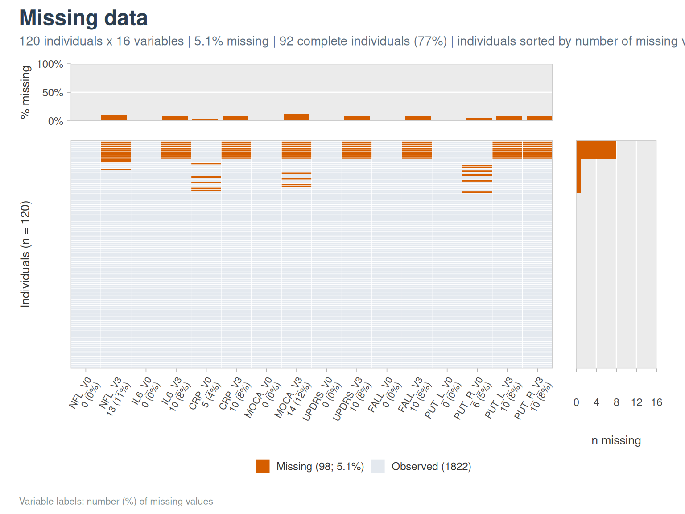
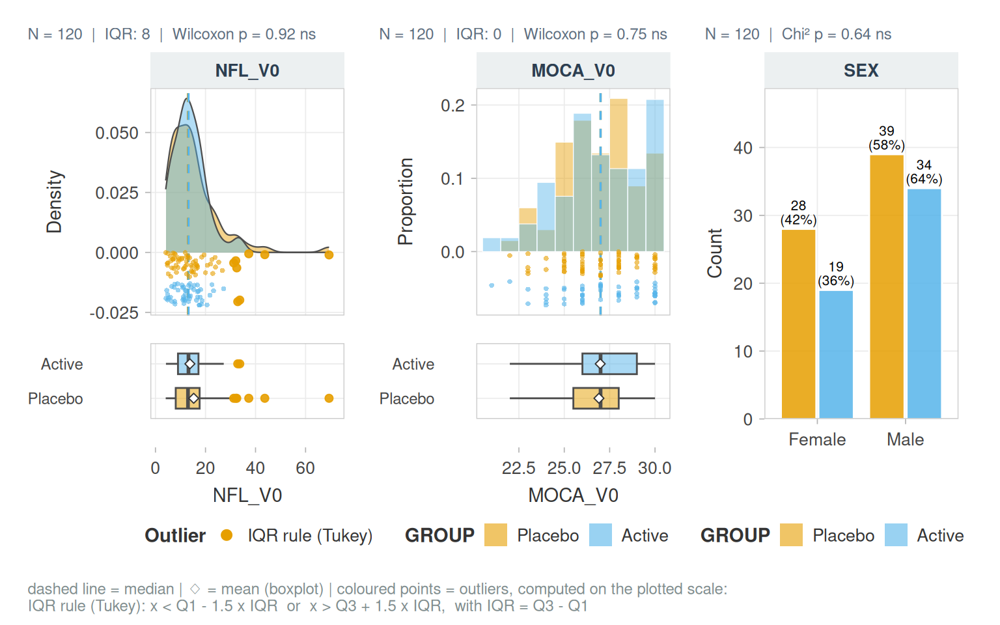

# Getting started with vernissage

*vernissage* puts your cohort on show: it turns raw cohort data into
clean variables, then into publication-ready figures and tables. It is
built for clinical cohorts stored in **wide format**: one row per
subject, one column per variable and visit, with names following the
`<ROOT>_<VISIT>` convention (`NFL_V0`, `NFL_V3`).

``` r

library(vernissage)
```

## The example cohort

Every vignette uses `cohort_sim`, a simulated cohort of 120 subjects in
two arms, measured at baseline (`_V0`) and follow-up (`_V3`). It has the
usual difficulties of real data: skewed biomarkers, values piled at a
limit of detection, outliers, bounded scores and missing values.

``` r

str(cohort_sim)
#> 'data.frame':    120 obs. of  21 variables:
#>  $ ID      : chr  "P001" "P002" "P003" "P004" ...
#>  $ GROUP   : Factor w/ 2 levels "Placebo","Active": 1 1 1 2 1 1 1 2 2 2 ...
#>  $ SEX     : Factor w/ 2 levels "Female","Male": 2 2 1 1 2 2 2 2 2 2 ...
#>  $ AGE     : num  80 82 67 72 51 69 61 64 69 73 ...
#>  $ BMI     : num  27.1 26.4 30.8 28.9 26 25.9 26.6 21.7 30.9 23.8 ...
#>  $ NFL_V0  : num  26.8 6.6 4.9 7.7 14.7 19.4 7.6 12 17.2 17.5 ...
#>  $ NFL_V3  : num  NA 8.5 5.2 7.2 21 27.1 9.6 14.7 15.6 14 ...
#>  $ IL6_V0  : num  2.59 1.04 1.2 1.81 0.83 1.01 0.76 0.9 0.52 2.25 ...
#>  $ IL6_V3  : num  NA 0.68 2.13 2.31 1.31 0.5 0.5 0.71 0.54 2.08 ...
#>  $ CRP_V0  : num  2.8 1.21 5.63 0.97 2.37 ...
#>  $ CRP_V3  : num  NA 0.73 4.09 1.01 1.64 4.28 9.22 1.26 1.62 0.88 ...
#>  $ MOCA_V0 : num  24 26 28 30 25 26 27 29 27 25 ...
#>  $ MOCA_V3 : num  NA 27 27 29 26 24 28 29 23 24 ...
#>  $ UPDRS_V0: num  20 7 15 4 34 22 1 33 29 5 ...
#>  $ UPDRS_V3: num  NA 12 21 1 36 25 5 37 32 6 ...
#>  $ FALL_V0 : Factor w/ 2 levels "No","Yes": 1 2 1 1 1 1 1 2 1 1 ...
#>  $ FALL_V3 : Factor w/ 2 levels "No","Yes": NA 2 1 1 2 1 1 1 1 1 ...
#>  $ PUT_L_V0: num  4.05 3.88 4.52 4.8 5.05 5.02 4.58 4.34 4.51 4.78 ...
#>  $ PUT_R_V0: num  3.74 3.77 4.5 4.65 5.32 5.05 4.41 4.24 4.29 4.68 ...
#>  $ PUT_L_V3: num  NA 3.88 4.44 4.76 5.03 5 4.56 4.32 4.53 4.76 ...
#>  $ PUT_R_V3: num  NA 3.74 4.47 4.62 5.22 5.03 4.37 4.23 4.32 4.54 ...
```

## A first look in three lines

``` r

describe_cohort(cohort_sim, vars = c(AGE, SEX, BMI, NFL_V0, IL6_V0, CRP_V0, MOCA_V0, FALL_V0),
                by = GROUP, id_col = ID,
                blocks = list(Demography = c("AGE", "SEX", "BMI"),
                              Biomarkers = c("NFL_V0", "IL6_V0", "CRP_V0"),
                              Clinical = c("MOCA_V0", "FALL_V0")))
```

[TABLE]

``` r

plot_na_map(cohort_sim, vars = c(NFL_V0:PUT_R_V3), id_col = ID)
```



``` r

plot_distribution(cohort_sim, c(NFL_V0, MOCA_V0, SEX), group = GROUP)
```



## Families of functions

Function names share a prefix by family, so that autocompletion lists
the family:

| Prefix | Purpose | Vignette |
|----|----|----|
| [`read_cohort_csv()`](https://clement-poupelin.github.io/vernissage/reference/read_cohort_csv.md), [`clean_colnames()`](https://clement-poupelin.github.io/vernissage/reference/clean_colnames.md), [`rename_with_map()`](https://clement-poupelin.github.io/vernissage/reference/rename_with_map.md) | import and names | Preprocessing |
| `visit_*()` | visit suffixes, long format, changes | Preprocessing |
| `outlier_*()` | robust outlier rules | Preprocessing |
| `transform_*()` | log, Box-Cox… | Preprocessing |
| `describe_*()`, `na_*()`, `cor_*()`, `pca_*()` | description | Describing a cohort |
| `plot_*()`, `theme_*()`, `pal_*()` | figures | Figures |
| `fmt_*()`, `label_*()`, `gt_*()`, `qmd_*()` | formatting and reports | Tables and reports |

## Selecting columns

Every argument that takes columns accepts character vectors (directly or
through a variable), bare names or tidyselect helpers:

``` r

vars <- c("NFL_V0", "IL6_V0")
nrow(outlier_detect(cohort_sim, vars, id_col = ID))
#> [1] 10
nrow(outlier_detect(cohort_sim, c(NFL_V0, IL6_V0), id_col = "ID"))
#> [1] 10
nrow(outlier_detect(cohort_sim, tidyselect::ends_with("_V0") & tidyselect::where(is.numeric), id_col = ID))
#> [1] 21
```

With a character vector, missing columns are dropped with a message;
with bare names, an unknown column is an error.

Limits of detection and cut-offs (median split, tertiles…) are in the
companion package
[lodestar](https://github.com/Clement-Poupelin/lodestar).

## Former names

The functions come from analysis scripts. Their former names
([`get_label()`](https://clement-poupelin.github.io/vernissage/reference/vernissage-deprecated.md),
[`paired_visits_plot()`](https://clement-poupelin.github.io/vernissage/reference/vernissage-deprecated.md),
[`radar_plot()`](https://clement-poupelin.github.io/vernissage/reference/vernissage-deprecated.md)…)
still work and point to the new ones; see `?vernissage-deprecated`. The
former limit-of-detection and cut-off functions (`make_cuts()`,
`handle_lod()`…) are in lodestar.
